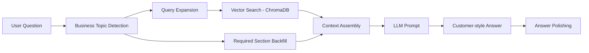

# MPCI Declaration Assistant

面向 UAE MPCI（Maritime Pre-Load Cargo Information）业务的智能申报问答助手。项目重点不是做一个普通文档聊天机器人，而是展示一个可评估、可迭代的业务型 RAG 应用：从手册解析、章节级知识库、业务主题路由、查询扩展、必要章节补齐，到客服式 Prompt 生成和质量评估。

## Portfolio Highlights

- **Hybrid RAG**：结合 ChromaDB 向量检索、业务主题识别、查询扩展和章节强制补齐。
- **Prompt Engineering**：将检索内容作为内部上下文，输出面向客户的操作建议，不暴露文档来源。
- **Business-Aware Routing**：识别申报时限、HBL、HS Code、To Order、Delegation、Consolidation、DNL/RFI、Party ID、提单更新等业务场景。
- **Bilingual QA**：支持中文和英文业务问题，回答语言跟随用户问题。
- **Evaluation Loop**：内置检索评估和客服回答评估，可生成 Markdown 报告。
- **Deployable API**：FastAPI 提供 Web UI 和 REST API，支持 DeepSeek / OpenAI-compatible / Claude / template fallback。

## What Makes It More Than a PDF Chatbot

普通 RAG 很容易出现两个问题：中文问题召回不到英文手册里的正确章节，或者回答像是在摘抄文档。这个项目加入了一个业务理解层：



核心设计文档：

- [RAG Design](docs/rag_design.md)
- [Evaluation](docs/evaluation.md)
- [System Prompt Design](prompts/system_prompt.md)

## Example Questions

```text
申报截止时间是多久？
Direct B/L 最晚什么时候申报？
多个 HS Code 怎么申报？
To Order 提单的收货人应该怎么填？
我是货代，但是我的下层货代直接给我货物，不需要我签发自己的提单，我应该怎么申报？
Is there any special document mandatory for HBL if shipper only provides general information?
If one house bill receives DNL, can the other house bills under the same master still be loaded?
```

## Project Structure

```text
MPCI/
├─ mpci_qa/
│  ├─ app.py                    # FastAPI app, API routes, built-in Web UI
│  ├─ server.py                 # Configuration-based server entry
│  ├─ rag_engine.py             # RAG orchestration, prompt assembly, answer generation
│  ├─ vector_store.py           # ChromaDB build/load/search logic
│  ├─ knowledge_base.py         # Section-aware chunking from pdf_text.txt
│  ├─ business_topics.py        # Business topic routing and required sections
│  └─ chunks/mpci_chunks.json   # Generated knowledge chunks
├─ docs/
│  ├─ rag_design.md             # RAG architecture and design decisions
│  └─ evaluation.md             # Evaluation methodology
├─ prompts/
│  └─ system_prompt.md          # Prompt design notes and iteration history
├─ scripts/
│  ├─ evaluate_retrieval.py     # Retrieval hit-rate check
│  ├─ evaluate_customer_answers.py
│  └─ generate_eval_report.py   # Markdown evaluation report generator
├─ tests/
│  ├─ eval_questions.json
│  └─ customer_questions.json
├─ pdf_text.txt                 # Extracted MPCI manual text
├─ .env.example
├─ requirements.txt
├─ Dockerfile
├─ start_mpci.bat
└─ README.md
```

## Quick Start

Requirements:

- Python 3.12+
- Windows / Linux / macOS
- Optional: DeepSeek, OpenAI-compatible, or Claude API key

Install dependencies:

```bash
pip install -r requirements.txt
```

Create `.env`:

```bash
copy .env.example .env
```

Example configuration:

```env
MPCI_LLM_TYPE=auto
OPENAI_API_KEY=your-deepseek-api-key
OPENAI_BASE_URL=https://api.deepseek.com/v1
OPENAI_MODEL=deepseek-chat

MPCI_HOST=0.0.0.0
MPCI_PORT=8000
MPCI_WORKERS=1
```

Start the server:

```bash
python -m mpci_qa.server
```

Open:

```text
http://localhost:8000
```

Health check:

```bash
curl http://localhost:8000/health
```

Expected response:

```json
{"status":"ok","service":"mpci-qa"}
```

## API Example

```bash
curl -X POST http://localhost:8000/api/chat ^
  -H "Content-Type: application/json" ^
  -d "{\"question\":\"Direct B/L 最晚什么时候申报？\",\"top_k\":5}"
```

Response fields:

- `answer`: customer-facing answer.
- `sources`: retrieved internal sections for debugging and evaluation.
- `confidence`: highest retrieval score.

The Web UI hides sources by default because end users should receive the answer, not the retrieval trace.

## Knowledge Base and Retrieval

Knowledge source:

```text
pdf_text.txt
```

Rebuild chunks and vector store:

```bash
python -m mpci_qa.knowledge_base
python -m mpci_qa.vector_store
```

Retrieval improvements are configured in `mpci_qa/business_topics.py`.

Example: a Chinese question about filing deadline can trigger English expanded queries such as:

```text
Filing Timing 24 Hours Pre-load 6 Hours Pre-load
filing deadline cutoff pre-load submission timing
```

The RAG engine then ensures that required sections such as `3.3` are present before building the final prompt.

## Evaluation

Run retrieval evaluation:

```bash
python scripts/evaluate_retrieval.py
```

Run customer-answer evaluation:

```bash
python scripts/evaluate_customer_answers.py
```

Generate a Markdown report:

```bash
python scripts/generate_eval_report.py
```

Report output:

```text
docs/eval_report.md
```

The evaluation covers scenarios such as:

- Filing timing
- HBL mandatory data
- HS Code and goods description
- Consignee / To Order
- Delegation
- Consolidation and co-loading
- DNL / RFI / PSF
- MPCI Party ID
- Bill of Lading update and split bill

## LLM Modes

- `auto`: use OpenAI-compatible API if `OPENAI_API_KEY` exists, otherwise Claude if configured, otherwise template mode.
- `openai`: use OpenAI SDK. Can connect to OpenAI, DeepSeek, or other compatible services.
- `claude`: use Anthropic Claude API.
- `template`: offline rule-based fallback for demo and debugging.

For best answer quality, use `auto` with a real model key.

## Docker

Build:

```bash
docker build -t mpci-qa .
```

Run:

```bash
docker run -d -p 8000:8000 --env-file .env mpci-qa
```

## Resume Talking Points

Possible resume bullets:

- Built a hybrid RAG assistant for UAE MPCI declaration support using FastAPI, ChromaDB, and LLM APIs.
- Designed business-topic routing with query expansion and required-section backfill to improve recall over an English regulatory manual for bilingual user questions.
- Engineered prompts and answer-polishing logic to convert retrieved rules into customer-service-style operational guidance.
- Created retrieval and answer-quality evaluation scripts with repeatable test datasets and Markdown report generation.

## Development Notes

- `.env`, logs, local vector store, and business fixture folders are ignored by Git.
- `mpci_qa/vector_store/` can be regenerated from `pdf_text.txt`.
- `app.py` contains the current built-in HTML/CSS/JS interface; there is no separate frontend build step.
- Adding a new business scenario should usually start in `business_topics.py`, then add retrieval and answer evaluation cases.

