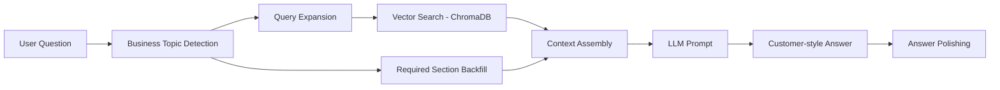

# RAG Design

This project is not a plain "PDF chat" wrapper. The RAG pipeline is designed for a narrow business domain: UAE MPCI declaration support. The main challenge is that users ask operational questions in Chinese or English, while the source manual is formal English and organized by business sections.

## Design Goals

- Give customer-service-style answers instead of quoting the manual.
- Support Chinese and English questions.
- Improve recall for business scenarios where semantic search alone is weak.
- Keep the final answer grounded in the MPCI specification.
- Make retrieval and answer quality measurable.

## Pipeline

## Knowledge Ingestion

Source text is stored in `pdf_text.txt`, extracted from the UAE MPCI Business Specification Document V1.0.

The ingestion code is in `mpci_qa/knowledge_base.py`.

Instead of fixed-length chunking, the project builds section-aware chunks:

- A section/page map identifies major manual sections.
- Section boundaries are trimmed by heading detection.
- Long appendix sections are split into smaller chunks.
- Each chunk keeps metadata such as title, section number, page reference, and type.

This is important because MPCI questions are usually answered by a specific section, not by a random nearby paragraph.

## Vector Store

The vector layer is implemented in `mpci_qa/vector_store.py`.

- Database: ChromaDB persistent local store.
- Collection: `mpci_knowledge`.
- Metadata: title, section number, page reference, chunk type.
- Retrieval: multi-query search with score merging and section boosting.

The vector store is generated locally under `mpci_qa/vector_store/` and is ignored by Git because it can be rebuilt.

## Business Topic Routing

The domain router is implemented in `mpci_qa/business_topics.py`.

It maps user questions to business topics such as:

- Filing timing
- Consignee / To Order
- HS Code and goods description
- HBL mandatory data
- Delegation
- Consolidation and co-loading
- DNL / RFI / PSF assessment
- MPCI Party ID
- Bill of Lading updates

Each topic can define:

- Trigger keywords in Chinese and English.
- Expanded English retrieval queries.
- Required manual sections.
- Section-level retrieval boost.

This makes the RAG system more reliable than pure semantic search, especially for Chinese questions against an English source document.

## Required Section Backfill

After vector retrieval, `RAGEngine._ensure_required_context()` checks whether the question matched a known business topic.

If the retrieved chunks missed important sections, the engine pulls those sections directly by section number and merges them into the context.

Example:

| Question Type | Required Sections |
|---|---|
| Filing deadline | `3.3` |
| HBL mandatory data | `3.2`, `5.1`, `5.2`, `6.1.3` |
| Consolidation / co-loading | `6.1`, `6.1.2`, `6.1.3`, `6.1.5` |
| DNL / RFI / PSF | `4.5`, `6.1.4` |
| Party ID | `5.3`, `5.3.1`, `5.3.2` |

This is the main reliability layer. It prevents a common RAG failure mode: retrieving a semantically similar but operationally incomplete passage.

## Prompt Construction

Prompt construction is handled in `mpci_qa/rag_engine.py`.

The prompt contains:

- Internal retrieved rules.
- Recent conversation history.
- A scenario inference hint generated from business topics.
- Strict answer style rules.
- Output language instruction.

The model is instructed to use retrieved content internally, but not expose references, section numbers, or "according to the document" language to the user.

## Answer Polishing

The final answer passes through `_polish_answer()`.

It removes customer-unfriendly phrases such as:

- "according to the document"
- "reference section"
- "from the manual"
- "MIG"
- source labels and internal reference markers

This layer exists because even a good prompt can occasionally leak retrieval mechanics into the user-facing answer.

## Why This Is Hybrid RAG

The project combines four methods:

- Semantic retrieval
- Keyword-based business routing
- Query expansion
- Deterministic section backfill

That hybrid design is intentional. In business compliance workflows, correctness depends on retrieving the right operational rule, not merely a similar paragraph.

